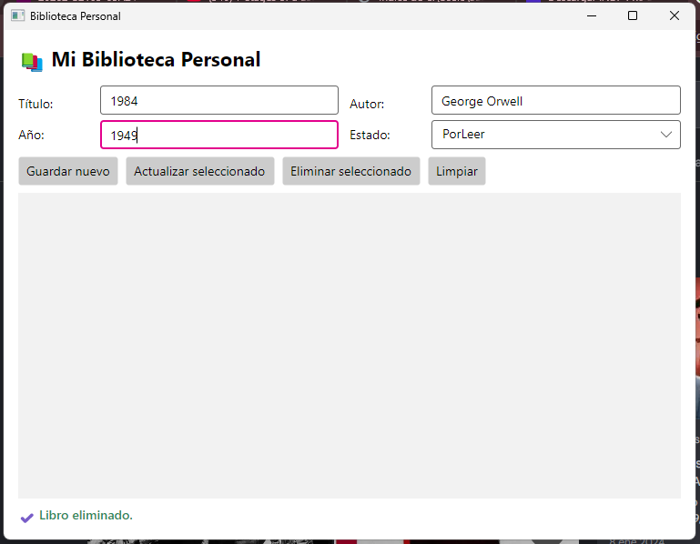
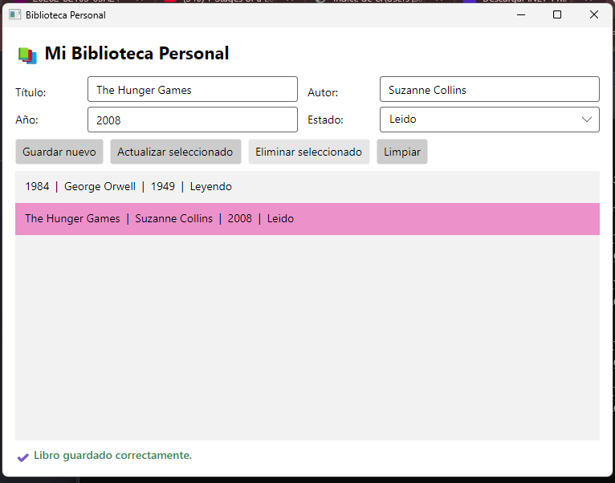
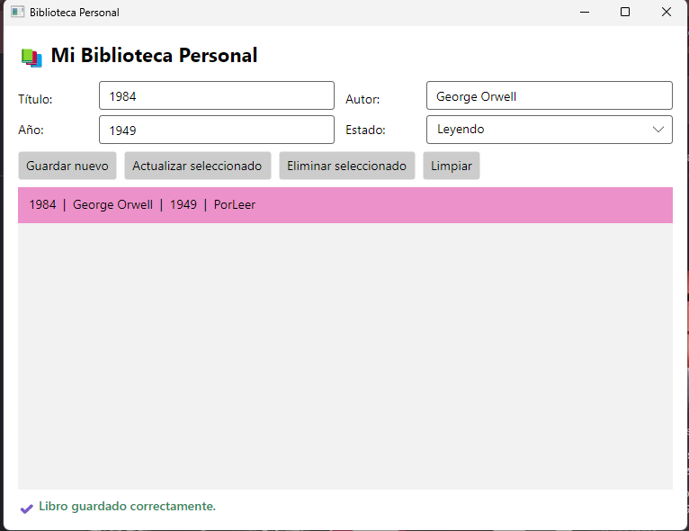
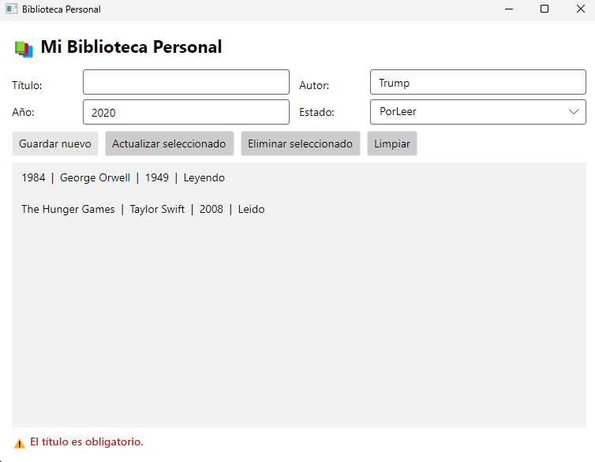
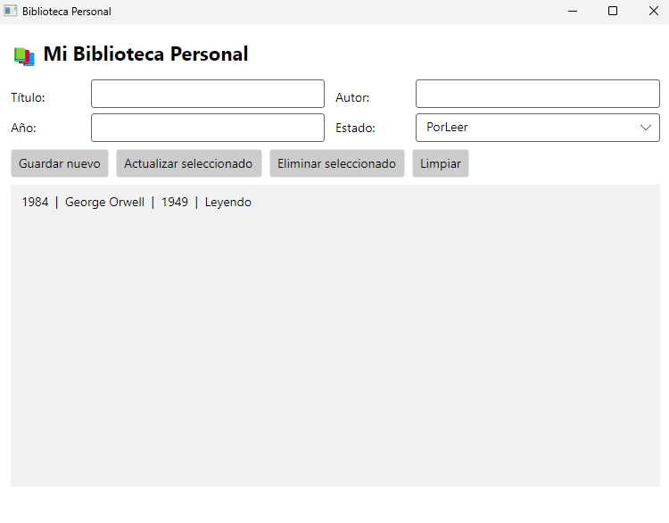

# PARCIAL-FINAL-DESARROLLO-DE-SOFTWARE-CON-.NET
# Biblioteca Personal

## 1. Información general
- **Estudiante:** Sabrina Mercado
- **Descripción:** Aplicación de escritorio para registrar y administrar los libros que una persona tiene o quiere leer.
- **Problema que resuelve:** Llevar el control de libros, autores y el estado de lectura sin depender de notas sueltas.
- **Objetivo:** Demostrar POO, interfaz con Avalonia UI y persistencia con ADO.NET + SQLite.

## 2. Funcionalidades
- Registrar un libro (título, autor, año, estado de lectura).
- Ver la lista de libros guardados.
- Seleccionar un libro y modificar sus datos.
- Eliminar un libro.
- Validaciones con mensajes claros (campos vacíos, año inválido) sin cerrar el programa.
- Los datos se conservan al cerrar y abrir la aplicación.

## 3. Tecnologías utilizadas
| Tecnología | Detalle |
|---|---|
| .NET | 11.0 |
| Lenguaje | C# |
| Interfaz | Avalonia UI 11.2.3 (archivos `.axaml`) |
| Acceso a datos | ADO.NET con `Microsoft.Data.Sqlite` 8.0.11 |
| Base de datos | SQLite |

Paquetes NuGet: `Avalonia`, `Avalonia.Desktop`, `Avalonia.Themes.Fluent`, `Microsoft.Data.Sqlite`.

## 4. Estructura del proyecto
```
BibliotecaPersonal/
├── BibliotecaPersonal.csproj
├── Program.cs
├── App.axaml / App.axaml.cs
├── Models/
│   ├── Libro.cs
│   └── EstadoLectura.cs
├── Data/
│   └── LibroDAO.cs
├── Services/
│   └── LibroServicio.cs
├── Views/
│   ├── MainWindow.axaml
│   └── MainWindow.axaml.cs
├── Database/
│   └── schema.sql
├── evidencias/
    └──01-registro.png
    └──02-consulta.png
    └──03-actualizacion.png
    └──04-eliminacion.png
    └──05-validacion.png
    └──06-persistencia.png
    └──dotnet restore.png
    └──dotnet run.png

└── README.md
```

### Clases principales y responsabilidades
| Clase | Responsabilidad |
|---|---|
| `Libro` | Representa un libro (datos + constructor + método `Actualizar`). |
| `EstadoLectura` | Enumeración: PorLeer, Leyendo, Leido. |
| `LibroDAO` | Acceso a datos: conexión SQLite y CRUD con SQL parametrizado. |
| `LibroServicio` | Lógica del programa: validaciones y coordinación con el DAO. |
| `MainWindow` | Interfaz gráfica y eventos (clic de botones, selección en lista). |

**Relación:** `MainWindow` → `LibroServicio` → `LibroDAO` → SQLite. La ventana nunca habla directamente con la base de datos.

### Dónde se aplica POO
- **Clases y objetos:** `Libro`, `LibroDAO`, `LibroServicio`, `MainWindow`.
- **Constructores:** `Libro(...)`, `LibroDAO(ruta)`, `LibroServicio(dao)`.
- **Encapsulamiento:** `Libro` usa `private set`; solo cambia mediante `Actualizar()`. Los campos `_dao` y `_servicio` son privados.
- **Separación de responsabilidades:** interfaz / lógica / datos en carpetas y clases distintas.
- **Sobrescritura:** `Libro.ToString()` define cómo se muestra en la lista.

## 5. Instalación de dependencias
1. Instalar el **SDK de .NET 8.0**: https://dotnet.microsoft.com/download
2. Verificar: `dotnet --version` (debe empezar con 8).
3. Clonar el repositorio:
   ```
   git clone <URL-DEL-REPOSITORIO>
   cd BibliotecaPersonal
   ```
4. Restaurar dependencias:
   ```
   dotnet restore
   ```
No se necesita ninguna configuración adicional.

## 6. Ejecución del programa
Desde la carpeta que contiene `BibliotecaPersonal.csproj`:
```
dotnet restore
dotnet run
```

## 7. Base de datos
- **Qué almacena:** los libros de la biblioteca.
- **Tabla `Libros`:** `Id` (PK autoincremental), `Titulo`, `Autor`, `Anio`, `Estado`.
- **Conexión:** `LibroDAO` crea un `SqliteConnection` con la cadena `Data Source=<ruta>/biblioteca.db`; cada operación abre y cierra la conexión con `using`.
- **CRUD:** todo está en `Data/LibroDAO.cs` (`Insertar`, `ObtenerTodos`, `Actualizar`, `Eliminar`), con parámetros (`$titulo`, `$id`, ...) para evitar inyección SQL.
- **Inicialización:** el archivo `biblioteca.db` y la tabla se **crean automáticamente** al abrir la aplicación por primera vez (`InicializarBaseDatos`). No hay que ejecutar nada extra. `Database/schema.sql` es solo de referencia.
- El archivo `.db` se genera junto al ejecutable (`bin/Debug/net8.0/`).

## 8. Evidencias de funcionamiento

| # | Prueba | Evidencia | Resultado |
|---|---|---|---|
| 1 | Registro |  | Se agregó un libro y apareció en la lista con mensaje de éxito. |
| 2 | Consulta |  | Se muestran todos los libros almacenados. |
| 3 | Actualización |  | Se cambió el estado de un libro y se guardó. |
| 4 | Eliminación |  | El libro eliminado dejó de aparecer. |
| 5 | Validación |  | Con el título vacío se muestra el error y el programa no se cierra. |
| 6 | Persistencia |  | Tras cerrar y reabrir, los libros siguen disponibles. |

## 9. Problemas encontrados y soluciones

**Problema:** Al principio la lista mostraba el nombre de la clase (`BibliotecaPersonal.Models.Libro`) en lugar de los datos del libro.
**Solución:** Sobrescribí el método `ToString()` en la clase `Libro` para que devuelva título, autor, año y estado.
